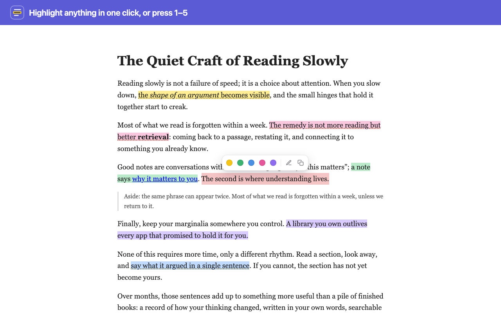

# RememberRemember — private web highlighter

Highlight and annotate any web page, add notes, and search everything you've saved later.
Everything is stored in `chrome.storage.local` in your own browser profile: no account,
no server, no analytics, no network requests.



## Features

- **One-click highlighting** in 5 colors from a toolbar at your selection, or keyboard-first: `1`–`5`, `N` (with note), `C` (copy)
- **Notes in place:** click a highlight to recolor it, write a note (autosaves), copy it or link to it, or delete it, with Undo
- **Side panel** per page: filter by color, search, jump to a passage, page note, Markdown export, pause per site
- **Library:** full-text search across all pages, color/site/notes filters, sort, backup and restore
- **Robust anchoring:** highlights are stored as text quotes with surrounding context and drawn with the
  CSS Custom Highlight API, so they survive layout changes and never modify the page
- **Light and dark** UI that matches the page you're reading

## Install

**From source (developer mode)**

1. Clone this repo.
2. Open `chrome://extensions` and turn on **Developer mode**.
3. Click **Load unpacked** and choose the repo folder.
4. Pin the extension from the puzzle-piece menu.

To highlight local HTML files, open the extension's **Details** and turn on **Allow access to file URLs**.

## Shortcuts

| Action | macOS | Windows / Linux |
| --- | --- | --- |
| Highlight selection (no toolbar) | `⌥⇧H` | `Alt+Shift+H` |
| Open side panel | `⌥⇧M` | `Alt+Shift+M` |
| With toolbar showing: color / note / copy | `1`–`5` / `N` / `C` | same |
| With a highlight open: delete / close | `⌫` / `Esc` | same |
| Finish a note | `⌘↵` | `Ctrl+Enter` |

Change them at `chrome://extensions/shortcuts`.

## Privacy

Nothing leaves your device. See [PRIVACY.md](PRIVACY.md). Removing the extension deletes its data,
so use Library → Settings → **Backup (.json)** first if you want to keep it.

## Development

```
manifest.json         MV3 manifest, permissions, strict CSP
shared.js             URL keys, settings, schema version, Markdown export
content.js / .css     text anchoring, highlight painting, selection toolbar, note popover
background.js         context menu, keyboard command, badge, install-time injection
sidepanel.*           per-page panel
library.*             all highlights, search, settings, backup/restore
ui.js / ui.css        shared tokens, icons, highlight card
test/                 chrome.* stub, harness pages, anchoring tests
scripts/              packaging and store screenshots
store/                Web Store listing text and images
```

No build step and no dependencies.

```bash
test/run-tests.sh          # anchoring tests in headless Chrome
python3 test/serve.py 8766 # manual harness: /test/article.html#panel, /test/workbench.html
scripts/package.sh         # dist/rememberremember-<version>.zip for the Web Store
scripts/screenshots.sh     # regenerate store/*.png
```

## License

[MIT](LICENSE)
